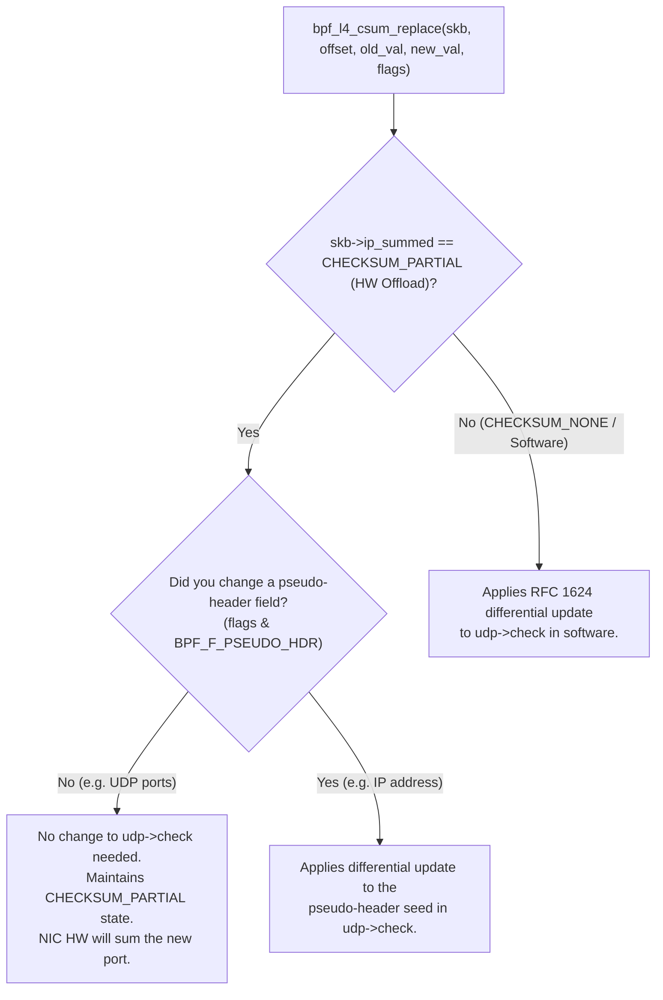

# Handling UDP Checksum Offloading in eBPF TC Filters

This document explains why `ip_summed` is not in `struct __sk_buff`, the concepts of the **Pseudo-Header Checksum** and **Differential Checksum Updates**, and how UDP checksum hardware offloading is handled within eBPF TC (traffic control) filters such as [`geneve-nat/udp-port-rewrite.c`](../geneve-nat/udp-port-rewrite.c).

---

## 1. Why `ip_summed` is Not in `struct __sk_buff`

- **Kernel Internal vs UAPI BPF Context:**
  - `ip_summed` is an internal field of the kernel's `struct sk_buff` (defined in `<linux/skbuff.h>`).
  - The BPF context struct `struct __sk_buff` (defined in `<linux/bpf.h>`) is a restricted, stable UAPI interface exposed to eBPF programs. The BPF verifier intentionally **does not expose `ip_summed`** directly in `struct __sk_buff`.

- **Internal Checksum States in `struct sk_buff`:**

  | Constant | Value | Egress (TX) Semantics |
  |---|:---:|---|
  | `CHECKSUM_NONE` | `0` | Software computed the checksum (or offload is not active). |
  | `CHECKSUM_UNNECESSARY` | `1` | Not used on egress. |
  | `CHECKSUM_COMPLETE` | `2` | Not used on egress. |
  | `CHECKSUM_PARTIAL` | `3` | **HW TX Checksum Offload active**: The kernel pre-seeds `udp->check` with the pseudo-header sum and expects the hardware/NIC to compute the final L4 payload checksum. |

---

## 2. Core Checksum Concepts

### A. What is the UDP Checksum? (RFC 768)

Under RFC 768, the IPv4 UDP checksum is a 16-bit 1's complement sum over three components:

```
+-----------------------------------------------------------+
| 1. IPv4 Pseudo-Header (Source IP, Dest IP, Proto=17, Len) |
+-----------------------------------------------------------+
| 2. UDP Header (Source Port, Dest Port, Length, Check=0)   |
+-----------------------------------------------------------+
| 3. UDP Payload (Packet Data)                              |
+-----------------------------------------------------------+
```

### B. What is the "Pseudo-Header Checksum" (and how HW Offload uses it)?

When **Hardware Checksum Offload (`CHECKSUM_PARTIAL`)** is active:
1. **The Host CPU avoids reading packet payload:** It only computes the 16-bit 1's complement sum of the **IP Pseudo-Header** (Source IP, Destination IP, Protocol, and UDP Length).
2. The CPU stores this partial sum into `udp->check` as a pre-seed and hands the packet buffer to the NIC driver with `ip_summed = CHECKSUM_PARTIAL`.
3. **The NIC hardware completes the checksum:** As the packet is transmitted, the NIC hardware computes the checksum over the UDP header and payload, adds it to the pre-seeded pseudo-header sum in `udp->check`, inverts it, and transmits the final packet.

#### Impact of Packet Header Modifications:
- **Modifying IP Addresses (`saddr` / `daddr`):** This alters the pseudo-header. The pre-seeded value in `udp->check` must be updated (notified to eBPF using the flag `BPF_F_PSEUDO_HDR`).
- **Modifying UDP Ports (`sport` / `dport`):** UDP ports are **not** part of the pseudo-header. Because the NIC hardware computes the UDP header and payload checksum anyway, rewriting a port does not invalidate the pseudo-header seed.

### C. What is a "Differential (Incremental) Checksum Update"? (RFC 1624)

When modifying a header field (e.g., rewriting `old_port -> new_port`), re-reading and summing the entire packet payload would require $O(N)$ memory reads, severely degrading throughput.

RFC 1624 defines how to compute the new checksum incrementally in $O(1)$ constant time using 1's complement arithmetic:

$$\text{New\_Checksum} = \sim (\sim \text{Old\_Checksum} + \sim \text{Old\_Value} + \text{New\_Value})$$

Where:
- $\text{Old\_Checksum}$ = current value in `udp->check`
- $\text{Old\_Value}$ = `old_port`
- $\text{New\_Value}$ = `new_port`

This math allows instantaneous checksum updates without touching packet payload bytes.

---

## 3. How eBPF Handles Checksum Offloading Automatically

Because `ip_summed` is private to `struct sk_buff`, the Linux kernel abstracts checksum offload handling inside the BPF helper **`bpf_l4_csum_replace()`**:

```c
long bpf_l4_csum_replace(struct __sk_buff *skb, __u32 offset,
                         __u64 from, __u64 to, __u64 flags);
```



1. **When HW Offload is Active (`CHECKSUM_PARTIAL`)**:
   - The kernel helper `bpf_skb_l4_csum_replace()` internally inspects `skb->ip_summed`.
   - When rewriting UDP ports (no `BPF_F_PSEUDO_HDR` flag), it preserves `CHECKSUM_PARTIAL` without corrupting the pseudo-header seed. The NIC hardware will include the updated port when summing the packet during transmission.
   - When rewriting IP addresses (with `BPF_F_PSEUDO_HDR`), it applies an incremental update to the pseudo-header seed in `udp->check`.

2. **When Software Checksum is Used (`CHECKSUM_NONE`)**:
   - The helper performs a 16-bit 1's complement incremental update of `udp->check` per RFC 1624.

3. **Handling Zero Checksum (`BPF_F_MARK_MANGLED_0`)**:
   - In IPv4 UDP, `udp->check == 0` means checksum is disabled / not calculated.
   - Passing `BPF_F_MARK_MANGLED_0` ensures that if an incremental update results in `0x0000`, it is set to `0xFFFF` so it is not misinterpreted as a disabled checksum.

---

## 4. Recommended Pattern for `udp_port_rewrite()`

When rewriting UDP ports:
- If `udp->check == 0`, the packet has UDP checksums disabled (standard IPv4 behavior). In that case, you do not need to call `bpf_l4_csum_replace()`.
- If `udp->check != 0`, call `bpf_l4_csum_replace()`. The kernel helper automatically handles whether the packet is software-checksummed or HW-offloaded (`CHECKSUM_PARTIAL`).

```c
/* Offsets must be computed before calling helpers that invalidate packet pointers */
__u32 udp_off   = (void *)udp - (void *)(long)skb->data;
__u32 dport_off = udp_off + offsetof(struct udphdr, dest);
__u32 csum_off  = udp_off + offsetof(struct udphdr, check);
__be16 check    = udp->check;

/*
 * If UDP checksum is enabled (check != 0), update it incrementally.
 * bpf_l4_csum_replace() internally checks skb->ip_summed:
 * - If CHECKSUM_PARTIAL (HW offload), it preserves offload state.
 * - If CHECKSUM_NONE (software sum), it updates the full checksum.
 */
if (check != 0) {
    if (bpf_l4_csum_replace(skb, csum_off, old_port, new_port,
                            BPF_F_MARK_MANGLED_0 | sizeof(new_port)) < 0) {
        bpf_printk("egress: failed to update UDP checksum");
        return TC_ACT_OK;
    }
}

/* Store new destination port */
if (bpf_skb_store_bytes(skb, dport_off, &new_port, sizeof(new_port), 0) < 0) {
    bpf_printk("egress: failed to rewrite dst port");
    return TC_ACT_OK;
}
```
