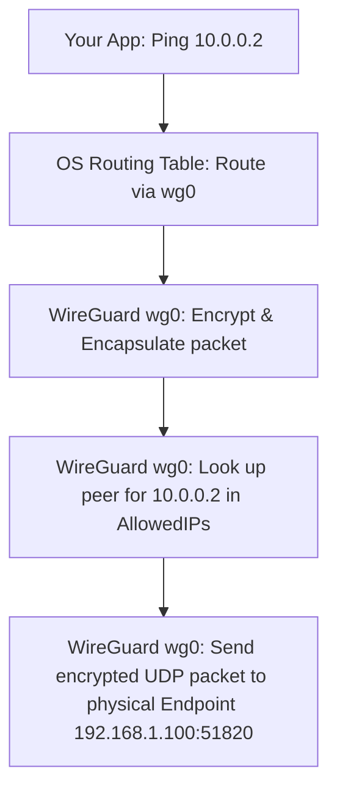

# WireGuard Configuration on Linux

This guide provides steps to configure a WireGuard interface on Linux, with a focus on manual configuration and key generation.

---

## Prerequisites

Install WireGuard tools on your distribution:

- **Ubuntu/Debian**:
  ```bash
  sudo apt update && sudo apt install wireguard
  ```
- **Fedora/CentOS/RHEL**:
  ```bash
  sudo dnf install wireguard-tools
  ```
- **Arch Linux**:
  ```bash
  sudo pacman -S wireguard-tools
  ```

---

## Key Generation

Every WireGuard node needs a secure private key and a corresponding public key.

To generate the keys securely:

```bash
# 1. Restrict file creation permissions for the current session
umask 077

# 2. Generate the private key
wg genkey > privatekey

# 3. Generate the corresponding public key from the private key
wg pubkey < privatekey > publickey
```

- **`privatekey`**: A base64-encoded 256-bit random private key. Keep this secure and secret.
- **`publickey`**: A base64-encoded 256-bit public key. Share this with your peers.

---

## Method A: Configuration via `wg-quick` (Recommended for persistence)

`wg-quick` simplifies setup by managing IP addresses, routes, and interfaces via a configuration file.

1. **Create the configuration file** at `/etc/wireguard/wg0.conf`:
   ```ini
   [Interface]
   PrivateKey = <local-private-key-contents>
   Address = 10.0.0.1/24
   ListenPort = 51820

   [Peer]
   PublicKey = <peer-public-key-contents>
   AllowedIPs = 10.0.0.2/32
   Endpoint = 192.168.1.100:51820
   PersistentKeepalive = 25
   ```

2. **Manage the interface**:
   - **Bring up**: `sudo wg-quick up wg0`
   - **Bring down**: `sudo wg-quick down wg0`
   - **Show status**: `sudo wg show wg0`
   - **Enable on boot**: `sudo systemctl enable wg-quick@wg0`

---

## Method B: Manual Configuration (Low-level `ip` and `wg` commands)

This approach is ideal for ephemeral tunnels, troubleshooting, or programmatic automation.

### 1. Create the link
Create a virtual network link of type `wireguard`:
```bash
sudo ip link add dev wg0 type wireguard
```

### 2. Assign the IP address
Set the IP subnet for the interface:
```bash
sudo ip address add dev wg0 10.0.0.1/24
```

### 3. Apply the Private Key
On systems with strict security policies (like AppArmor on Ubuntu), the `wg` binary is only permitted to read from whitelisted directories such as `/etc/wireguard/`. Direct paths in home directories or special files like `/dev/stdin` or process substitution will result in `Permission denied` or `No such file or directory` errors.

To apply the key successfully:

```bash
# Copy key to the whitelisted wireguard directory
sudo mkdir -p /etc/wireguard
sudo cp privatekey /etc/wireguard/privatekey
sudo chmod 600 /etc/wireguard/privatekey

# Set the private key from the whitelisted path
sudo wg set wg0 private-key /etc/wireguard/privatekey listen-port 51820

# (Optional) Delete the temporary key file if not wanted on disk
sudo rm /etc/wireguard/privatekey
```

### 4. Configure a Peer
Associate a peer public key and allow specific IP traffic:
```bash
sudo wg set wg0 peer <peer-public-key> allowed-ips 10.0.0.2/32 endpoint 192.168.1.100:51820
```

### 5. Bring the interface up
Activate the interface:
```bash
sudo ip link set up dev wg0
```

### 6. Verify status
View active interface statistics and peers:
```bash
sudo wg show wg0
```


---

## Understanding WireGuard Endpoints vs. AllowedIPs

A common point of confusion is what the `endpoint` parameter represents. 

**`endpoint` is NOT the IP address of the peer's virtual WireGuard interface.**

Instead, **`endpoint` is the physical/underlay IP address and port** of the remote machine that is reachable over your actual physical network (such as the Internet or a LAN).

### Underlay vs. Overlay Network

To understand how WireGuard routes traffic, think of two separate networks: the **Physical Network (Underlay)** and the **WireGuard VPN Tunnel (Overlay)**.

| Parameter | Network Type | Description | Example |
| :--- | :--- | :--- | :--- |
| **`endpoint`** | **Physical Network (Underlay)** | The real-world IP address and UDP port of the remote machine. This is where WireGuard encapsulates and sends the encrypted UDP traffic. | `192.168.1.100:51820` (LAN) <br> or `203.0.113.5:51820` (Public WAN) |
| **`AllowedIPs`** | **VPN Tunnel (Overlay)** | The IP address assigned to the peer's virtual WireGuard interface inside the tunnel. This tells WireGuard: *"Any traffic destined for this IP should be encrypted and sent to the associated physical `endpoint`."* | `10.0.0.2/32` |

### Traffic Routing Flow

When you send a ping from your machine (`10.0.0.1`) to the peer's WireGuard IP (`10.0.0.2`):



### Important Practical Notes
1. **One-sided Endpoints (Server/Client model)**: Only one peer needs to have a defined `endpoint` (the one acting as the "server" with a reachable, static physical IP). Once the client connects to the server's endpoint, the server will automatically learn and update the client's physical endpoint from the incoming UDP traffic.
2. **Dynamic Nat Hole-Punching**: If both peers are behind NAT, you can use a keep-alive setting (`PersistentKeepalive = 25`) to keep connections open, but generally at least one peer must be reachable via a public/resolvable IP or port-forward.


---

## Do I need to run `wg set peer` on both ends?

Yes! **You must configure a peer relationship on both ends of the tunnel.**

However, the common point of confusion is that you only need to specify the physical **`endpoint`** on **one end** (usually the client side).

### Why both sides must configure a peer

WireGuard uses **Cryptokey Routing**. Each node maintains a database of peer public keys and the internal VPN (overlay) IPs they are allowed to use. 

If you only configure the peer on Node A:
1. Node A knows Node B's public key, so Node A will encrypt traffic and send it to Node B.
2. Node B receives the packets, but since **Node B has not registered Node A as a known peer**, Node B doesn't recognize Node A's public key.
3. Node B will silently discard the incoming packets as unauthorized traffic.

### How to configure both sides (Client/Server Example)

Assume **Node A** (Client behind NAT/firewall, `10.0.0.1`) wants to connect to **Node B** (Server with static physical IP, `10.0.0.2`):

#### 1. On Node A (Client side)
Node A must know Node B's public key, its AllowedIPs, and where to reach Node B physically via its public IP/port (`endpoint`):
```bash
sudo wg set wg0 \
  peer <Node-B-Public-Key> \
  allowed-ips 10.0.0.2/32 \
  endpoint 192.168.1.100:51820
```

#### 2. On Node B (Server side)
Node B must know Node A's public key and its authorized VPN IP inside the tunnel (`allowed-ips`). **You do not need to specify an `endpoint` here**:
```bash
sudo wg set wg0 \
  peer <Node-A-Public-Key> \
  allowed-ips 10.0.0.1/32
```

### How the connection establishes dynamically

1. **Initiation**: Node A sends a packet to Node B's physical IP and port (`192.168.1.100:51820`).
2. **Authentication**: Node B receives the packet, matches it against Node A's registered public key, and verifies the cryptographic signature.
3. **Endpoint Learning**: Once the handshake succeeds, Node B **dynamically learns and stores Node A's physical IP address and port** from the incoming UDP packet header.
4. **Bidirectional Communication**: From this point on, Node B can route packets back to Node A dynamically without needing a pre-configured, hardcoded endpoint for Node A.


---

## Can I add multiple peers to the same interface?

Yes, absolutely! WireGuard is designed to support **multiple peers on a single interface**. This is how you build both **Hub-and-Spoke** (Star) topologies and **Full Mesh** networks.

Every time you run the `wg set` command with a different public key, it adds a new peer to that interface (or updates it if it is already registered).

### How to Add Multiple Peers

For example, on a Hub server (`10.0.0.1`), you can add multiple spokes:

```bash
# Add Peer 1 (Spoke A - e.g., Laptop)
sudo wg set wg0 peer <Peer-1-Public-Key> allowed-ips 10.0.0.2/32

# Add Peer 2 (Spoke B - e.g., Phone)
sudo wg set wg0 peer <Peer-2-Public-Key> allowed-ips 10.0.0.3/32

# Add Peer 3 (Spoke C - e.g., Cloud VM)
sudo wg set wg0 peer <Peer-3-Public-Key> allowed-ips 10.0.0.4/32
```

Alternatively, you can chain them in a single command:
```bash
sudo wg set wg0 \
  peer <Peer-1-Public-Key> allowed-ips 10.0.0.2/32 \
  peer <Peer-2-Public-Key> allowed-ips 10.0.0.3/32 \
  peer <Peer-3-Public-Key> allowed-ips 10.0.0.4/32
```

### ⚠️ The Golden Rule: No Overlapping `AllowedIPs`

Because WireGuard uses **Cryptokey Routing**, it acts as a routing table where `AllowedIPs` acts as the lookup key. 

* **Rule**: You cannot have the same `AllowedIPs` (e.g., `10.0.0.2/32`) assigned to more than one peer on the same interface. 
* If you assign `10.0.0.2/32` to Peer 2 when it was already assigned to Peer 1, WireGuard will remove it from Peer 1 and assign it to Peer 2 (the last one configured wins).

Each peer must have a unique set of IPs/subnets assigned to its `AllowedIPs` configuration.

### Useful Commands for Multi-Peer Management

#### 1. See all configured peers on the interface
```bash
sudo wg show wg0
```

#### 2. Remove a specific peer
To remove a peer from the interface, use the `remove` keyword:
```bash
sudo wg set wg0 peer <Peer-Public-Key> remove
```


---

## Troubleshooting: Ping Packet Loss despite Successful Handshake

A common issue during manual configuration is that the WireGuard handshake is successful, and you can see incoming ICMP echo requests (via `tcpdump -i wg0`) on the destination host, but no ping reply is sent.

### Case Analysis

If `tcpdump` on Site B shows:
```text
192.168.100.1 > 192.168.100.2: ICMP echo request
```
But no `ICMP echo reply` is generated:

#### Cause 1: Local Firewall (e.g., UFW or iptables)
Local firewall rules on the receiving host (Site B) are dropping the incoming packets after they are decrypted but before the kernel processes them. Since `tcpdump` captures packets before the firewall filter, you will see the incoming request but no reply.

**Solution**:
Allow traffic on the `wg0` interface:
- **Using UFW (Ubuntu/Debian)**:
  ```bash
  sudo ufw allow in on wg0
  ```
- **Using raw iptables**:
  ```bash
  sudo iptables -A INPUT -i wg0 -j ACCEPT
  ```

#### Cause 2: Missing Return Route on the Receiving Host
If the receiving host was configured with a `/32` IP address (e.g. `ip address add 192.168.100.2/32 dev wg0`), the OS does not automatically add a subnet route. The host receives the request, but when generating the reply to `192.168.100.1`, it sends it via the default gateway (e.g., `ens3`) instead of back through the tunnel.

**How to verify**:
On Site B, run:
```bash
ip route get 192.168.100.1
```
If the output shows any interface other than `wg0`, the return traffic is misrouted.

**Solution**:
Set the IP with a `/24` subnet mask so the kernel adds the route automatically:
```bash
# Re-add with /24
sudo ip addr del 192.168.100.2/32 dev wg0 2>/dev/null
sudo ip addr add 192.168.100.2/24 dev wg0
```
Or manually add the specific route:
```bash
sudo ip route add 192.168.100.1/32 dev wg0
```


---

## Troubleshooting: Geneve over WireGuard — tcpdump reports "invalid" inner IP length

### Symptom

Geneve traffic is carried over `wg0` (MTU 1420), and the inner interface is `geneve0` (MTU 1378):

```text
geneve0: mtu 1378, inet 192.168.42.100/24
wg0:     mtu 1420, inet 192.168.100.1/24
```

A maximum-size ping works (`ping -M do -s 1350 -c 1 192.168.42.4`), but `tcpdump -v -i wg0` shows:

```text
IP (tos 0x0, ttl 64, id 40110, offset 0, flags [+], proto UDP (17), length 1420)
    192.168.100.1.34142 > 192.168.100.2.6081: Geneve, Flags [none], vni 0x2a,
    options [class Open vSwitch (0x101) type 0x2a len 12 data 90010000 64000000]
        IP [total length 1378 > length 1358] (invalid) (... proto ICMP (1), length 1378)
    192.168.42.100 > 192.168.42.4: ICMP echo request, id 48597, seq 1, length 1358
```

### Why tcpdump complains

The inner packet is not malformed. The **outer** packet was fragmented:

- The outer IP header has `flags [+]` (More Fragments) and `offset 0`, so this is only the **first fragment**.
- tcpdump decodes the first fragment, sees an inner IP header claiming 1378 bytes, but only 1358 bytes are present. It reports `[total length 1378 > length 1358] (invalid)`.
- The remaining bytes are in a second fragment. tcpdump does not reassemble fragments.

### Where the bytes go

| Layer | Bytes |
|---|---|
| Outer IP | 20 |
| UDP | 8 |
| Geneve base header | 8 |
| Geneve option (OVS class, `len 12`) | 12 |
| Inner Ethernet | 14 |
| Inner IP packet (the ping) | 1378 |
| **Total** | **1440** |

The total of 1440 is larger than the `wg0` MTU of 1420. The first fragment carries 1400 bytes of payload after the 20-byte outer IP header. Subtracting UDP (8), Geneve (20 including options) and Ethernet (14) leaves 1358 bytes of inner IP, which matches the tcpdump output. The remaining 20 bytes go in a second fragment.

The `geneve0` MTU of 1378 does not account for the 12-byte Geneve option. Something in the path adds it, such as the eBPF code or OVS-style metadata.

### Fix

**Option 1: Lower the `geneve0` MTU to match the real overhead.**

```text
1420 (wg0) - 20 (IP) - 8 (UDP) - 8 (Geneve) - 12 (options) - 14 (Ethernet) = 1358
```

```bash
sudo ip link set geneve0 mtu 1358
```

The largest ping payload is then `1358 - 20 (IP) - 8 (ICMP) = 1330`:

```bash
ping -M do -s 1330 -c 1 192.168.42.4
```

If the Geneve option is not added, an MTU of 1370 is enough.

**Option 2: Raise the underlay MTU.**

If the path under WireGuard allows it, raise `wg0` accordingly. WireGuard adds 60 bytes of overhead over IPv4 and 80 over IPv6, so the usual default is 1500 - 80 = 1420.

### Notes

- `ping -s` sets only the ICMP payload. The kernel adds an 8-byte ICMP header and a 20-byte IPv4 header, so `-s 1370` means a 1398-byte packet. On a 1378-byte MTU with `-M do`, this fails locally with `Message too long`, and nothing appears on `geneve0`.
- Fragmenting the outer packet hurts performance, because WireGuard must encrypt each fragment separately.
- After the fix, `tcpdump -v -i wg0` should show no `flags [+]` on the outer IP header and no `(invalid)` on the inner IP header.


---

## Does the MTU include the Ethernet header?

No. The MTU is the largest L3 payload an interface can send. For Ethernet, that is the IP packet. The Ethernet header (14 bytes, or 18 with a VLAN tag) and the FCS are not counted. An MTU of 1500 means a 1500-byte IP packet, which is a 1514-byte frame on the wire (1518 with FCS).

### What this means for Geneve over WireGuard

- **Outer Ethernet header:** It does not count against the underlay MTU. On `wg0` there is none at all, because it is an L3 interface (`link/none`).
- **Inner Ethernet header:** It does count. Geneve carries a full Ethernet frame, so the inner 14-byte header is part of the UDP payload and takes space from the underlay MTU.

The `geneve0` MTU (the inner IP packet size) is therefore:

```text
geneve0 MTU = underlay MTU - 20 (outer IP) - 8 (UDP) - 8 (Geneve) - options - 14 (inner Ethernet)
            = 1420 - 20 - 8 - 8 - 12 - 14 = 1358
```

The usual Geneve overhead over IPv4 without options is 50 bytes: 20 (outer IP) + 8 (UDP) + 8 (Geneve) + 14 (inner Ethernet). The outer Ethernet header is not part of it.
